<div style="display: flex; align-items: center; justify-content: space-between; gap: 20px;">
  <div>
    <h3>🚀 Fullstack Explorer</h3>
    <p>A finished project is a dead project, so I leave them unfinished :trollface:</p>
  </div>
  
</div>


## 💻 About Me

```bash
name: "Pedro Henrique Nogueira"
location: "Based on the internet"
about: "Focused on frontend, backend, and everything in between"
right-now: "Currently exploring AI integrations and creative tooling"
graduation: "Bachelor's degree in Software Engineering from Universidade de Brasília"
contact: "By smoke signal or via the LinkedIn link in my bio."
likes:
  - Coffee ☕
  - Movies 🎞️
  - Video Games 🎮
  - Basketball 🏀
```


## 🛠️ Tech Stack

<table>
  <tr>
    <td align="right"><b>⚙️ Languages</b></td>
    <td>
      
    </td>
  </tr>
  <tr>
    <td align="right"><b>🎨 Frontend</b></td>
    <td>
      
    </td>
  </tr>
  <tr>
    <td align="right"><b>🧠 Backend</b></td>
    <td>
      
    </td>
  </tr>
  <tr>
    <td align="right"><b>📝 Database</b></td>
    <td>
      
      
    </td>
  </tr>
  <tr>
    <td align="right"><b>☁️ Cloud & Tools</b></td>
    <td>
      
    </td>
  </tr>
</table>


## 📌 Selected Projects

### 🎲 Sabe Jogar? – AI Agent for Board Games  
**Sabe Jogar?** is your smart companion for tabletop adventures. Whether you're diving into a new board game or revisiting a classic, Sabe Jogar? helps you get started fast by explaining the rules and guiding players through the first round. No more flipping through manuals — just ask, play, and enjoy.  
> 🧠 Powered by AI to simplify game onboarding and enhance group play.

### 🎤 PICHIT – Pitch Presentation Generator  
**PICHIT** is a sleek software tool designed to help you craft compelling pitch presentations for your ideas, products, or visuals. Whether you're preparing for investors, clients, or a creative showcase, PICHIT guides you through structure, tone, and visuals to make your pitch pop.  


## 👾 Contribution Pac-Man
<div align="center">
  <picture>
    <source media="(prefers-color-scheme: dark)" srcset="https://raw.githubusercontent.com/phnog/phnog/output/pacman-contribution-graph-dark.svg" />
    <source media="(prefers-color-scheme: light)" srcset="https://raw.githubusercontent.com/phnog/phnog/output/pacman-contribution-graph.svg" />
    
  </picture>
</div>


## 🎮 Now Playing
<div align="center">
  
</div>
